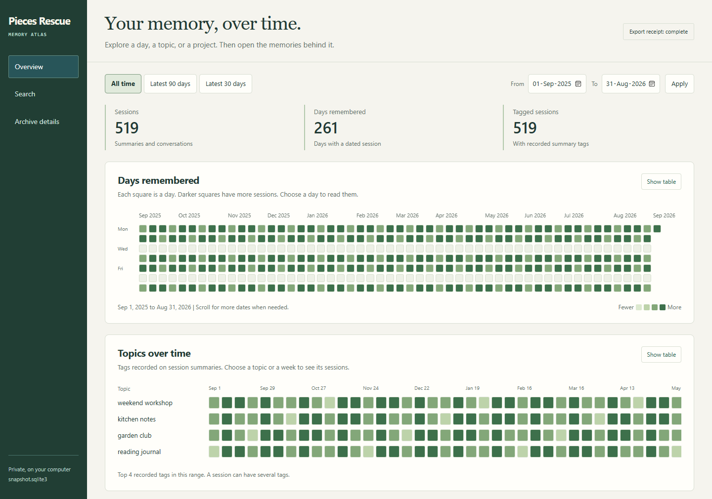
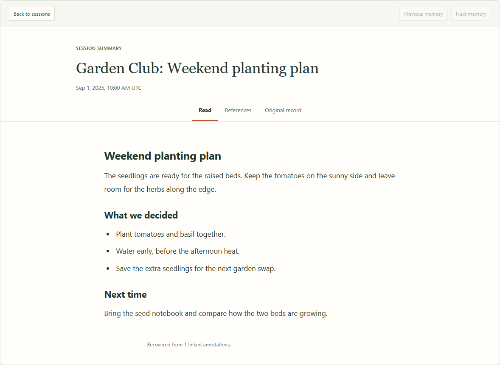
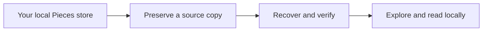

# Pieces Rescue

Keep the memories you captured with Pieces. Pieces Rescue saves a copy of your
local store and supporting files, recovers readable summaries and conversations,
and gives you a visual way back into them. Everything runs on your computer,
without a Pieces account or a running Pieces service.

**[Download the Windows x64 beta](https://github.com/anthony-maio/pieces-rescue/releases/tag/v0.1.0-beta.1)**
| [Watch the 22-second demo](https://github.com/anthony-maio/pieces-rescue/releases/download/v0.1.0-beta.1/brag.mp4)
| [Get help](SUPPORT.md)

This is an unsigned, opt-in beta. Clean-machine Windows testing and independent
customer recovery testing remain open. Keep your original Pieces data.



*Sample memories, not customer data. Choose a day or a topic to open the sessions
behind it. The charts count summaries and conversations, not every captured event.*

## From a remembered day to the full text

Browse the calendar, follow a recorded topic, or search your recovered text. Open
a session to read its summary or conversation, with its original record and
references available alongside it.



*The full reader, using an invented Garden Club summary. Missing references stay
visible. Subject groups in the overview are detected from titles; recorded topic
tags come from the archive.*

## Save your memories

1. Download `pieces-rescue-0.1.0-beta.1-windows-x64.zip` from the release above.
   Download `SHA256SUMS.txt` if you want to verify its SHA-256 checksum.
2. Extract the entire ZIP. Keep `_internal` beside `PiecesRescue.exe`.
   The app bundles its runtime; you do not need to install Python.
3. Quit Pieces OS and Pieces for Developers, including their tray apps.
   Keep their data folders and do not uninstall or clear data first.
4. Open `PiecesRescue.exe`, choose your Pieces database and a private local
   destination, then click **Save my memories**.
5. Open the overview when recovery and verification finish. Choose a day or
   topic, then open the memories behind it. Keep the launcher open while reading.

## What it saves



| Saved layer | What it contains | Why keep it |
| --- | --- | --- |
| Source copy | A database snapshot including committed WAL content | Retains the selected store for future recovery work |
| Supporting files | Attachments, format files and vector files, when present | Preserves files alongside the database; their original app features are not rebuilt |
| Readable export | Raw records, decoded documents, searchable summaries and conversations | Lets you explore and read the content recovered from that store |
| Verification receipts | File checksums, counts and recovery progress | Lets you check saved files and retry interrupted work |

The preserved source and raw export are separate from the rebuildable charts and
search index. If recovery is interrupted, keep the destination and use **Open /
retry saved archive**. Completed files are verified before reuse.

The tool can only recover content present in the selected store. A successful
export does not prove that every past memory was on this computer. Preserve
different stores separately and keep your originals.

## Keep the archive private

The archive is plaintext and can contain secrets. Its preserved database includes
account records; those collections are excluded from the readable export by
default. There are no uploads, analytics or automatic updates.

Use a private local folder, preferably on an encrypted drive. Public issues
should contain only safe diagnostic counts and a description of the failed step,
never databases, manifests, memory text, or screenshots of private content.

## Documentation and support

- [Full instructions](README.txt)
- [Beta scope and validation limits](BETA_NOTES.md)
- [Troubleshooting and safe diagnostics](SUPPORT.md)
- [Archive format](FORMAT.md)
- [Report a problem](https://github.com/anthony-maio/pieces-rescue/issues)

Windows x64 is the beta target. macOS, Linux and Windows ARM remain unverified.
The current evidence comes from one Windows development machine and one user's
source data, plus the portable synthetic tests in Windows CI. CI tests the source;
it does not validate the packaged app on a clean Windows installation.
Independent recovery evidence and a signed distribution channel are needed
before a stable release.

## Development

Source use requires Python 3.10+ with SQLite FTS5, plus Tk for the launcher.
The packaged Windows build uses Python 3.14.

```text
python -m unittest discover -v
node --check viewer.js
python launcher.py
```

To build a new Windows package on Windows:

```text
python -m pip install -r requirements-build.txt
python build_release.py NEW_BUILD_FOLDER --windows
```

The builder uses an explicit source allowlist. Keep personal archives outside
the repository; never add them to Git or attach them to a public issue.
`SOURCE_SHA256.json` records the source files in the original beta package.

MIT license. Maintainer: Anthony Maio. See [LICENSE](LICENSE) and
[THIRD_PARTY.txt](THIRD_PARTY.txt).
